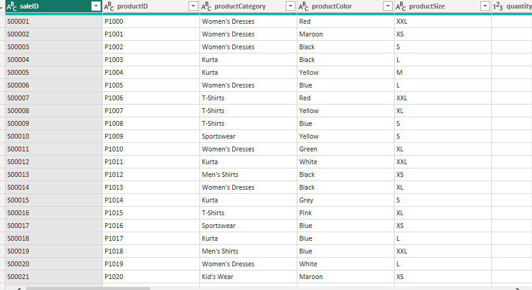

# Threading-the-Data-An-Analysis-of-the-World-of-Apparel

## Executive Summary
This clothing sales dashboard is a helpful tool for store managers and bosses to track money, sales, and stock. By turning 10,000 sales records into simple facts, the dashboard helps leaders see what people like to buy, which stores do best, and how to stop losing money from cancelled or returned items.

## Business Context
In the clothing business, it is important to know more than just total sales. Shoppers buy clothes in different ways, in physical stores, on websites, and through mobile apps. Because running a shop costs money, leaders need to choose the best items to sell, fix shipping or order problems, and keep both store shoppers and online buyers happy.

## Objectives
This report looks at three main questions:
- Which types of clothing make the most money?
- How well do different shopping channels (like in-store, online, and mobile apps) work?
- How many orders get cancelled or returned, and how can we fix that?

## Data Overview
The dataset includes thousands of transactions that show key details like how customers pay, what sizes they buy, the types of clothing sold, and more.

## Data Preview

## Data Cleaning and Transformation
Deduplicated the dataset using Power Query to ensure data integrity.
Filtered out null values to eliminate incomplete records.
Standardized column headers for improved clarity and readability.

## Detailed Findings & Analysis
### Key Performance Indicators
-**Total Net Profit:** $6.80M generated across all sales.
-**Lost Profit:** $2.73M lost due to order cancellations and returns.
-**Lost Revenue:** $10.82M in uncollected revenue from cancelled and returned orders.
-**Average Order Value:** $2.72K per transaction.
